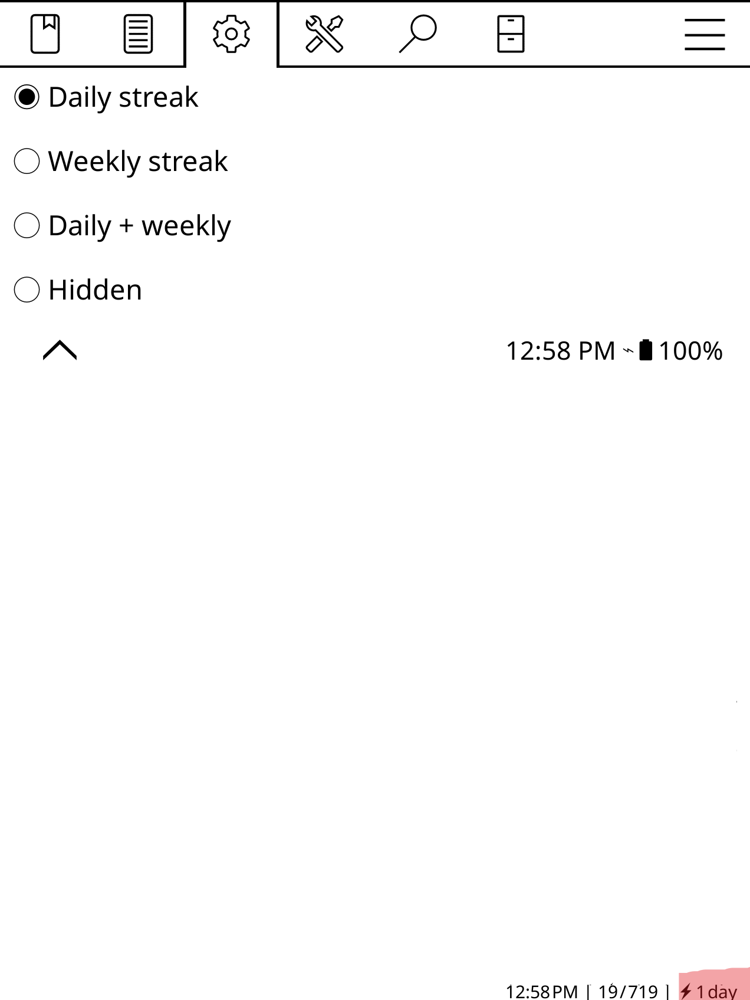
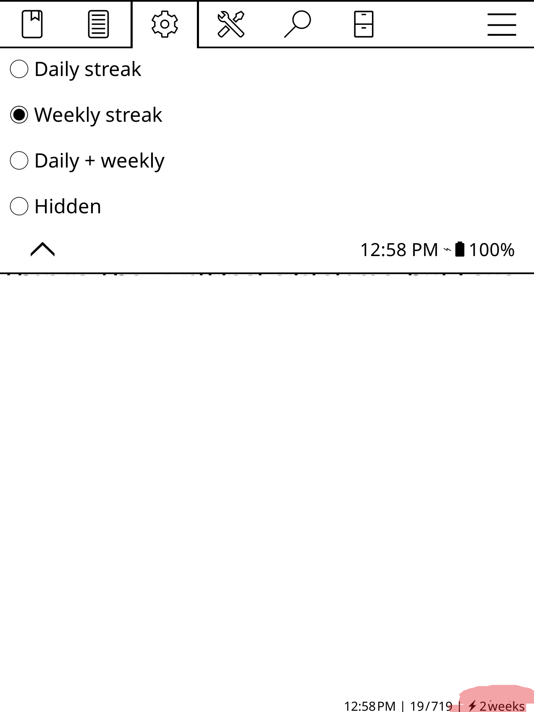
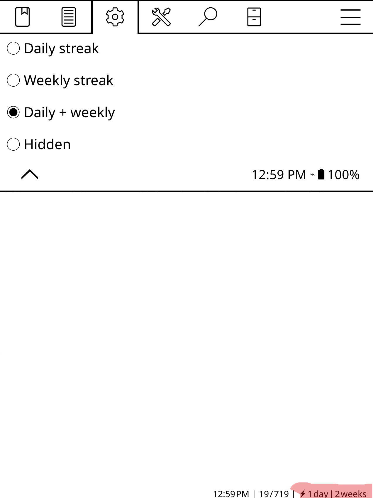
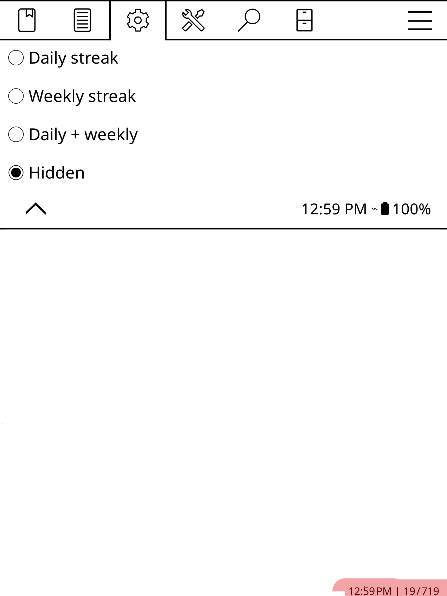
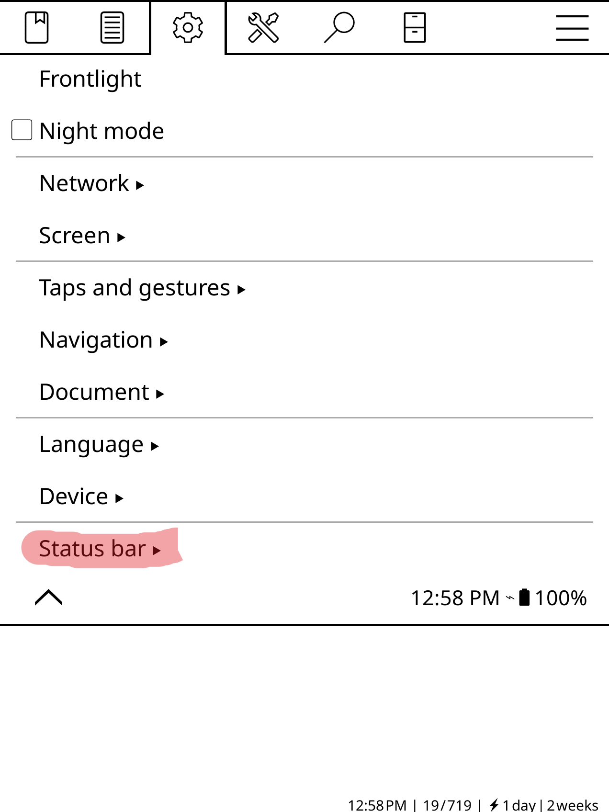
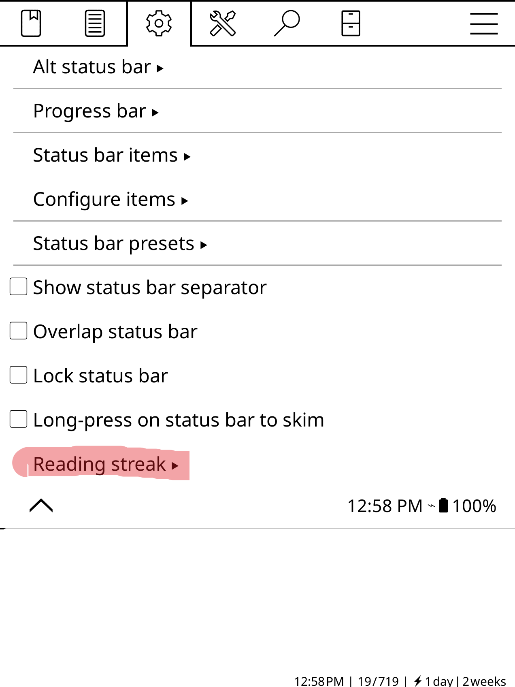

# ⚠️ **AI-ASSISTED CODE NOTICE** ⚠️

## **This patch and its README were written and troubleshot with Claude.**

**Claude wrote the code and documentation, and helped debug it. I tested it on my own device and described the results back, but I'm not a Lua or KOReader developer, and the code has not been reviewed by an expert.** It has only been tested on my setup, so it may behave differently on yours. Use it at your own risk, and back up your `koreader` folder first.

---

### **Not affiliated: This patch is an independent, unofficial project. It is not affiliated with, endorsed by, or maintained by the author of the Reading Streak plugin (advokatb) or the KOReader project. It only reads data that the Reading Streak plugin makes available. Please report problems with this patch here, not to the plugin's author.**

---

# Reading Streak in the KOReader Status Bar

A KOReader user patch that shows your reading streak in the status bar while you read, so you can see it without leaving the book. You choose what to show from KOReader's own menu: the daily streak, the weekly streak, both, or nothing.

The text is appended to the end of whatever the status bar already shows (page number, time, battery, etc.).

## What it looks like

**Daily streak** (default): `⚡ 12 days`

**Weekly streak:** `⚡ 3 weeks`

**Daily + weekly:** `⚡ 12 days | 3 weeks`

**Hidden:** the status bar returns to normal

## What it does

[Reading Streak](https://github.com/advokatb/readingstreak.koplugin) by advokatb tracks daily and weekly reading streaks. By default you view your streak by going to **Tools → Reading Streak**, and the plugin can also show it in the Project: Title file browser footer. It does not show the streak while you are reading.

This patch fills that gap. It reads the streak data and adds it to KOReader's own reading status bar.

## Requirements

- KOReader with user patch support (a `koreader/patches/` folder)
- The [Reading Streak plugin](https://github.com/advokatb/readingstreak.koplugin), installed and enabled
- **Tools → Reading Streak → Settings → UI Integration → "Export to Project Title"** turned on. This is required: the plugin only publishes its streak data to other code when this is enabled, and the patch shows nothing without it.

Project: Title may not be required. This is a plain KOReader patch, not a Project: Title patch, because the reading status bar belongs to KOReader itself. In one user's testing with Project: Title turned off, the streak still showed, but this hasn't been confirmed on other setups. The "Export to Project Title" setting may simply be the name of the switch that controls whether the Reading Streak plugin shares its data.

## Installation

1. Install the Reading Streak plugin by copying its `readingstreak.koplugin` folder into KOReader's `plugins` folder.
2. Create a `patches` folder inside your `koreader` folder if it doesn't exist.
3. Copy `2-reader-footer-streak.lua` into `koreader/patches/`.
4. Turn on **Export to Project Title** in the Reading Streak settings (see above).
5. Restart KOReader and open a book.

You can check that the patch loaded under **Patch Management**.

## Choosing what to show

While reading, open the top menu and go to **Settings (cog) → Status bar → Reading streak** (the entry is at the bottom of the Status bar list).

Pick one:

| Option | Shows |
|---|---|
| Daily streak | `⚡ 12 days` (default) |
| Weekly streak | `⚡ 3 weeks` |
| Daily + weekly | `⚡ 12 days \| 3 weeks` |
| Hidden | nothing |

The choice is saved in KOReader's settings and applies to all books.

## Configuration

Options at the top of `2-reader-footer-streak.lua`:

| Setting | Default | Description |
|---|---|---|
| `SYMBOL` | `"⚡"` | Symbol shown before the streak. Set to `""` for text only, or if the symbol doesn't render in your footer font. |
| `SEPARATOR` | `" \| "` | Text between the daily and weekly streaks when showing both. |
| `SHOW_WHEN_ZERO` | `false` | If `true`, a streak of 0 is shown instead of hidden. |
| `DEFAULT_MODE` | `"daily"` | What is shown until you pick something in the menu. |
| `WEEK_STARTS_ON_MONDAY` | `true` | Set to `false` for Sunday-start weeks (affects the calculated weekly streak only). |
| `CACHE_SECONDS` | `60` | How long the calculated weekly streak is cached, to avoid re-reading the file on every page turn. |
| `WEEK_FIELDS` | see file | Names the patch looks for if the plugin publishes a weekly streak. |

## How it works

- **Daily streak:** the plugin publishes its data under `PluginShare.readingstreak`, with `current_streak` and a `getStreakText()` function. The patch reads those.
- **Weekly streak:** the patch first looks for a weekly number in `PluginShare.readingstreak` using the names in `WEEK_FIELDS`. If none is found, it calculates the weekly streak itself from the reading dates saved in `reading_streak.lua` in KOReader's settings folder. A week counts if you read on at least one day in it. If you haven't read yet this week, last week's streak is still shown until the week ends.
- **Display:** the patch wraps `ReaderFooter.init` and registers a footer content function with `ReaderFooter:addAdditionalFooterContent(...)`. It also wraps `ReaderFooter:addToMainMenu` to add the **Reading streak** entry to the Status bar menu.

## Troubleshooting

- **Nothing appears:** make sure the status bar is visible while reading, the plugin is enabled, **Export to Project Title** is on, and the menu option isn't set to Hidden. Then restart KOReader.
- **Check the log:** look in `crash.log` in your koreader folder for lines starting with `reader-footer-streak:`.
  - `PluginShare.readingstreak is nil` means the plugin isn't publishing its data to the reader.
  - `addAdditionalFooterContent not found` means your KOReader version doesn't have that hook.
  - `could not find the Status bar menu` means the menu entry couldn't be added. The footer text still works, and you can change `DEFAULT_MODE` in the file instead.
  - `PluginShare.readingstreak keys: ...` lists everything the plugin publishes. If it includes a weekly field not in `WEEK_FIELDS`, add that name to the list.
- **Weekly number differs from the plugin's:** see the limitations below, and check the `keys:` log line described above.
- **Symbol shows as a box or blank:** set `SYMBOL = ""`.
- **Streak is 0 or missing after a new day:** the streak updates when the plugin records your reading, usually when you open or read a book.

## Limitations

- If the plugin doesn't publish a weekly number, the patch calculates it using Monday-start weeks (configurable), counting a week if you read on any day in it. In testing, this matched the plugin's own weekly streak.
- Edge cases could still differ from the plugin: the calculation reads any `YYYY-MM-DD` dates in the plugin's saved data, so if you use daily page or time targets and the plugin stores dates for days that didn't meet them, those days could be counted.
- The patch depends on the plugin's internal data, so a future plugin update could break it.
- The setting is global, not per book.

## Credits

- [Reading Streak plugin](https://github.com/advokatb/readingstreak.koplugin) by advokatb. This patch is not affiliated with it and only displays the data it provides.
- [KOReader](https://github.com/koreader/koreader). This patch is not affiliated with the KOReader project.
